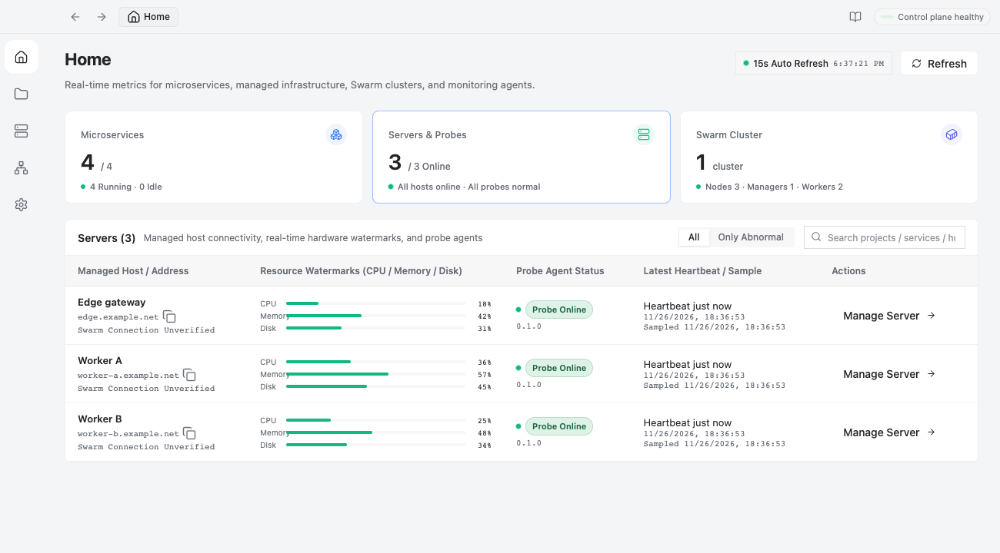
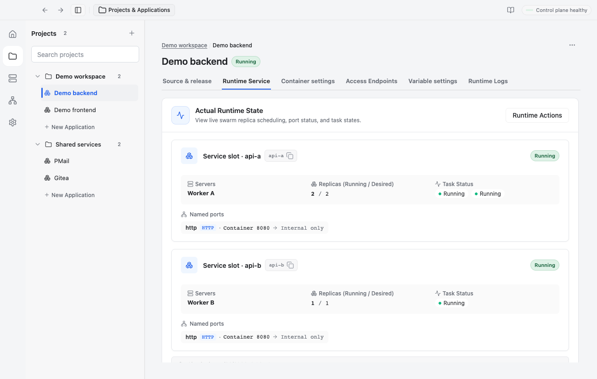
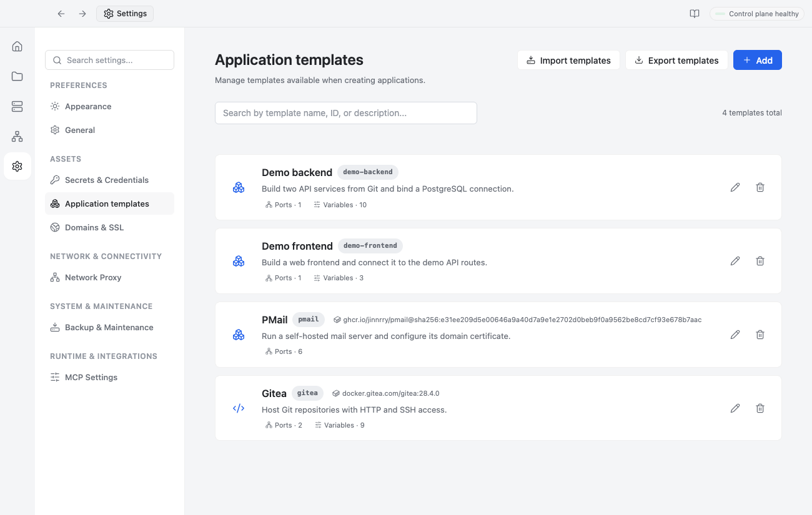
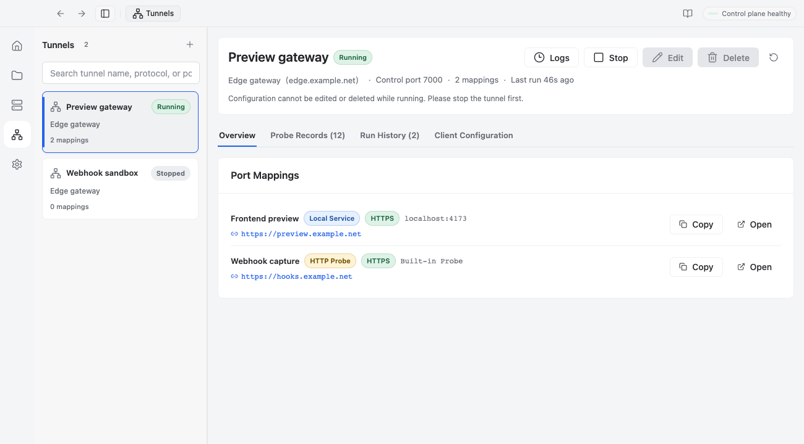

# iQuji Ops

[简体中文](README.zh-CN.md) · [Download installers](https://github.com/haydardsx/iquji-community-ops/releases) · [Report an issue](https://github.com/haydardsx/iquji-community-ops/issues)

iQuji Ops is a desktop application for deploying and monitoring self-hosted services on Linux servers. Connect a server over SSH, build an application with Jenkins or deploy a container image, and follow its Docker Swarm replicas, routes and logs from the same workspace. The source is available under a [personal, noncommercial license](LICENSE).



The screenshots show the English interface with fictional data. The app also supports Simplified Chinese.

## Install

Choose an installer for your operating system and processor from [GitHub Releases](https://github.com/haydardsx/iquji-community-ops/releases). The release includes `SHA256SUMS` for verifying downloads.

| Platform | Installer |
| --- | --- |
| macOS, Apple silicon | `macos-arm64.dmg` |
| macOS, Intel | `macos-x64.dmg` |
| Windows, x64 | `windows-x64.exe` (NSIS) |
| Linux, amd64 | `linux-amd64.deb` for Debian-compatible systems with WebKitGTK 4.1 |

Official installers are built from a tagged source revision on native GitHub-hosted runners for macOS, Windows and Linux. Each installer is tested on its target platform before publication. See the release notes for signature and system requirements.

## Deploy an application

1. In **Servers**, add a Linux host you administer. Verify its SSH host fingerprint, then check the host's runtime components. Configure Docker Swarm for deployment and Jenkins for builds from Git.
2. In **Projects**, create a project and add an application. Select a template, then choose a Git repository or container image as the source. Configure service placement, ports, environment variables and any credentials the application needs.
3. Open **Source & release** to build or release the application. Use **Runtime Service** to inspect the running replicas, **Access Endpoints** to manage routes and **Runtime Logs** to inspect service output.



The monitoring dashboard groups applications by project. Switch to the server view for resource usage and heartbeat times, or to Swarm for cluster, node, service and task information.

## Application templates

The built-in catalogue includes **Demo backend**, **Demo frontend**, **PMail** and **Gitea**. The demo backend defines two API service slots. The frontend consumes their routes. PMail and Gitea start from container images. In **Settings → Application templates**, you can edit templates or export and import the catalogue as JSON. Changes apply to applications created afterwards.



The two demo repositories are independent MIT-licensed projects. Their templates build from the source in those repositories. [Demo backend](https://github.com/haydardsx/demo_deploy_backend) · [Demo frontend](https://github.com/haydardsx/demo_deploy_frontend)

## Tunnels and routing

Use **Tunnels** to forward a local service through a managed server with FRP. Give each mapping a public route, or direct incoming requests to the built-in HTTP probe for webhook testing. The detail view shows the public endpoints, received probe requests and run history. Manage application domains and HTTPS certificates in **Settings**.



## Backups and local MCP

In **Settings → Backup & Maintenance**, select the resources to export, preview the backup and optionally include operation logs. Including secret material requires an encryption passphrase. Restore an archive by choosing its scopes and reviewing conflicts before applying it.

In **Settings → MCP Settings**, create a client for the local Model Context Protocol (MCP) interface. Select its commands and allowed targets, then copy the connection configuration. Guidance permission lets the client point to a release control for a particular application. Direct execution requires its own grant and can require confirmation.

For a guided walkthrough, grant the tutorial commands for the `project-create` target. The bundled client uses the executable and environment shown in the connection configuration.

```sh
iquops-mcp call tutorial_start '{"target":"project-create"}'
iquops-mcp call tutorial_hint '{"target":"project-create","step":"name","message":"Enter a project name here."}'
```

## Built with iQuji Community Web

The React client uses eight MIT-licensed npm packages from [iQuji Community Web](https://github.com/haydardsx/iquji-community-web). The lockfile pins all eight to `0.2.2`.

| Package | Where it is used |
| --- | --- |
| [`web-component`](https://www.npmjs.com/package/@iquji-community/web-component) | Forms, dialogs, tables and interactive terminals |
| [`web-editor`](https://www.npmjs.com/package/@iquji-community/web-editor) | Command, JSON and tunnel configuration editors |
| [`web-i18n`](https://www.npmjs.com/package/@iquji-community/web-i18n) | English and Simplified Chinese |
| [`web-icons`](https://www.npmjs.com/package/@iquji-community/web-icons) | Navigation and action icons |
| [`web-motion`](https://www.npmjs.com/package/@iquji-community/web-motion) | Interface transitions |
| [`web-network`](https://www.npmjs.com/package/@iquji-community/web-network) | HTTP requests and the terminal channel |
| [`web-query`](https://www.npmjs.com/package/@iquji-community/web-query) | Server state and query caching |
| [`web-theme`](https://www.npmjs.com/package/@iquji-community/web-theme) | Light, dark and system themes |

## Build for personal use

The Tauri desktop app starts a local Go API and worker. The API serves the web client. A separate Go monitoring agent reports metrics from managed servers.

Install Bun 1.3.14, Node 26, Go 1.26.11 and Rust 1.97.1 with `rust-docs`. Native prerequisites include Xcode Command Line Tools on macOS, the MSVC build tools and WebView2 on Windows, and WebKitGTK 4.1 development libraries on Linux. The [desktop workflow](.github/workflows/desktop.yml) lists the build dependencies for each platform.

```sh
bun install --cwd client --frozen-lockfile
bun run --cwd client check
go -C server test ./...
go -C agent test ./...
bun run --cwd client desktop:build
```

For a personal build using local runtime files, set `IQUOPS_FRP_ARCHIVE` to the target's frp 0.69.1 release archive. Set `IQUOPS_JENKINS_PLUGINS_DIR` to a directory containing the locked plugins named `<plugin ID>.jpi`. The build verifies their SHA-256 digests. [Jenkins plugin lockfile](server/resources/runtime/managed/jenkins/plugins.lock)

## License

iQuji Ops uses a source-available license. Individuals may read, build and run the unmodified application free of charge for personal, noncommercial use. Company, organization or team use, modification, redistribution and commercial use require separate permission from the relevant copyright holder. Third-party components retain their own licenses. [License](LICENSE) · [Third-party notices](THIRD_PARTY_NOTICES.md) · [Contribution guide](CONTRIBUTING.md)
