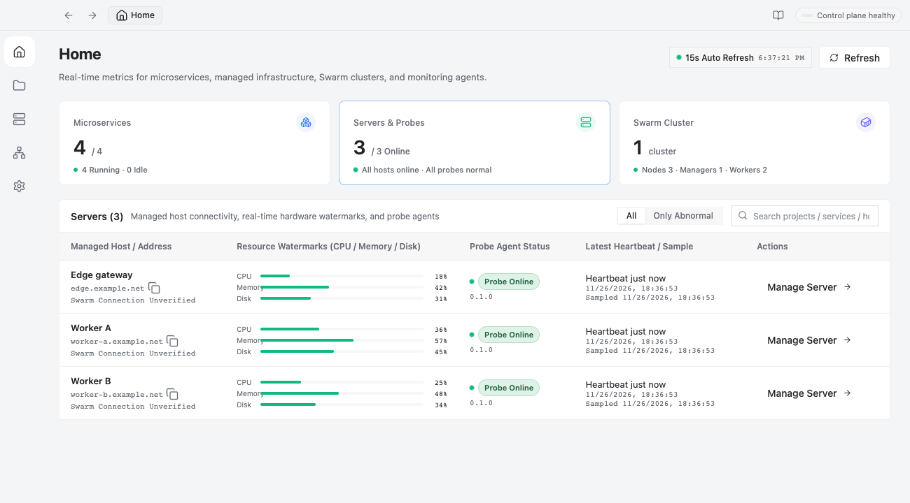
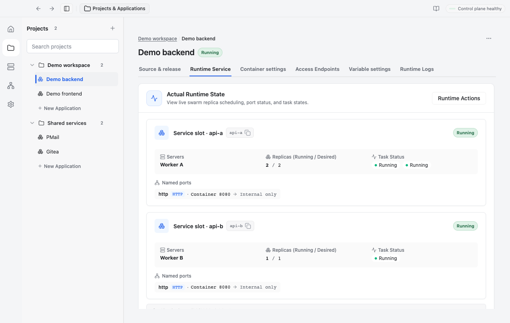
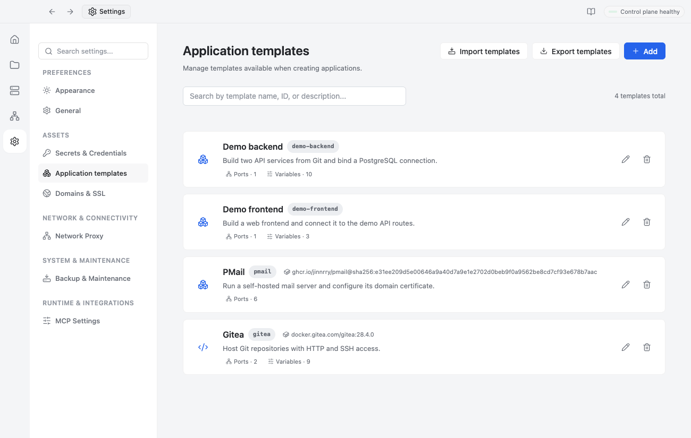
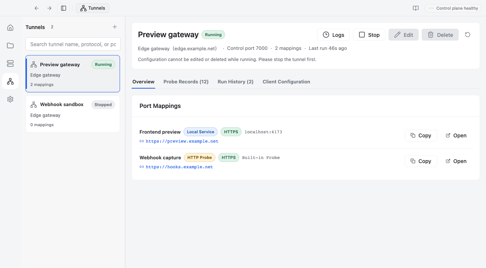

# iQuji Ops

[English](README.md) · [下载安装包](https://github.com/haydardsx/iquji-community-ops/releases) · [报告问题](https://github.com/haydardsx/iquji-community-ops/issues)

iQuji Ops 是一款桌面运维应用，用于在 Linux 服务器上部署和监控自托管服务。通过 SSH 连接服务器后，你可以用 Jenkins 从 Git 构建应用，也可以直接部署容器镜像，再在同一工作区查看 Docker Swarm 副本、访问路由和运行日志。应用采用允许个人非商业使用的[源码可见许可](LICENSE)。



截图使用英文界面与虚构演示数据。应用也支持简体中文。

## 安装

在 [GitHub Releases](https://github.com/haydardsx/iquji-community-ops/releases) 中按系统和处理器选择安装包，可使用同一版本附带的 `SHA256SUMS` 核对下载文件。

| 系统 | 安装包 |
| --- | --- |
| macOS，Apple 芯片 | `macos-arm64.dmg` |
| macOS，Intel 处理器 | `macos-x64.dmg` |
| Windows，x64 | `windows-x64.exe`（NSIS 安装程序） |
| Linux，amd64 | `linux-amd64.deb`，适用于带有 WebKitGTK 4.1 的 Debian 兼容系统 |

正式安装包由 GitHub 托管的 macOS、Windows、Linux 原生运行器从版本标签对应的源码构建，在各自平台测试后发布。签名状态和系统要求见对应版本的发行说明。

## 部署第一个应用

1. 在「服务器」中添加你管理的 Linux 主机，核验 SSH 主机指纹，再检查运行组件。部署应用需要配置 Docker Swarm；从 Git 构建还需要配置 Jenkins。
2. 在「项目」中新建项目并添加应用。选用模板后，根据应用需要设置 Git 仓库或容器镜像、目标节点、端口、环境变量与凭据。
3. 在应用的「来源与发布」页构建或发布应用，随后可在「运行服务」中核对实际副本，在「访问入口」中管理路由，在「运行日志」中查看服务输出。



监控首页可按项目查看应用状态，切换到服务器视图可比较资源占用和最近心跳，切换到 Swarm 视图可查看集群、节点、服务和任务。

## 应用模板

内置模板包括**演示后端、演示前端、PMail 和 Gitea**。演示后端定义两个 API 服务槽位，演示前端使用它们的访问路由。PMail 与 Gitea 使用容器镜像。在「设置 → 应用模板」中可编辑模板，或以 JSON 文件导出和导入模板目录。修改模板只影响此后创建的应用。



两个演示模板各自从独立的 MIT 许可项目构建，源码见[后端示例](https://github.com/haydardsx/demo_deploy_backend)和[前端示例](https://github.com/haydardsx/demo_deploy_frontend)。

## 隧道与路由

在「隧道」中可通过 FRP 和受管服务器转发本地服务。给各个映射配置公开路由，或者把请求指向内置 HTTP 探针，用于调试 Webhook。隧道详情展示公开入口、探针收到的请求和运行历史。应用使用的域名与 HTTPS 证书可在「设置」中管理。



## 备份与本地 MCP

在「设置 → 备份与数据维护」中选择导出范围并预览备份内容，可按需加入操作日志。包含凭据原文时必须设置加密口令。恢复备份时可先选择范围并检查冲突，再执行恢复。

需要让 AI 协助操作时，在「设置 → MCP 设置」中新建本地 Model Context Protocol（MCP）客户端，选定命令及允许访问的目标，复制连接配置。给某个应用授予发布引导后，客户端可指出该应用的发布控件。直接执行发布需要单独授权，也可要求现场确认。

例如，将教程命令授权给 `project-create` 目标后，使用连接配置中给出的随包程序和环境启动创建项目的引导。

```sh
iquops-mcp call tutorial_start '{"target":"project-create"}'
iquops-mcp call tutorial_hint '{"target":"project-create","step":"name","message":"请填写项目名称。"}'
```

## 使用的 iQuji Community 项目

React 客户端使用 [iQuji Community Web](https://github.com/haydardsx/iquji-community-web) 提供的八个 MIT 许可 npm 包，锁文件将它们固定为 `0.2.2`。

| 包 | 在 iQuji Ops 中的用途 |
| --- | --- |
| [`web-component`](https://www.npmjs.com/package/@iquji-community/web-component) | 表单、对话框、表格与交互终端 |
| [`web-editor`](https://www.npmjs.com/package/@iquji-community/web-editor) | 命令、JSON 与隧道配置编辑器 |
| [`web-i18n`](https://www.npmjs.com/package/@iquji-community/web-i18n) | 简体中文和英文界面 |
| [`web-icons`](https://www.npmjs.com/package/@iquji-community/web-icons) | 导航与操作图标 |
| [`web-motion`](https://www.npmjs.com/package/@iquji-community/web-motion) | 界面过渡动效 |
| [`web-network`](https://www.npmjs.com/package/@iquji-community/web-network) | HTTP 请求与终端连接 |
| [`web-query`](https://www.npmjs.com/package/@iquji-community/web-query) | 服务端状态查询与缓存 |
| [`web-theme`](https://www.npmjs.com/package/@iquji-community/web-theme) | 浅色、深色和跟随系统的主题 |

## 个人使用的本地构建

Tauri 桌面应用启动本地 Go API 与 Worker，由 API 提供 Web 界面。独立的 Go 监控 Agent 从受管服务器上报指标。

安装 Bun 1.3.14、Node 26、Go 1.26.11，以及带有标准库文档 `rust-docs` 的 Rust 1.97.1。macOS 需要 Xcode Command Line Tools，Windows 需要 MSVC 构建工具和 WebView2，Linux 需要 WebKitGTK 4.1 开发库。各平台的构建依赖见[桌面构建工作流](.github/workflows/desktop.yml)。

```sh
bun install --cwd client --frozen-lockfile
bun run --cwd client check
go -C server test ./...
go -C agent test ./...
bun run --cwd client desktop:build
```

个人构建可使用本地运行组件。将 `IQUOPS_FRP_ARCHIVE` 指向目标平台的 frp 0.69.1 发行归档，将 `IQUOPS_JENKINS_PLUGINS_DIR` 指向存有锁定插件的目录，插件文件名使用 `<插件 ID>.jpi`。构建过程会核对 SHA-256 摘要。[Jenkins 插件锁文件](server/resources/runtime/managed/jenkins/plugins.lock)

## 许可

iQuji Ops 使用源码可见许可。个人可免费阅读、构建和原样运行本软件，用于个人非商业用途。公司、组织或团队使用，以及修改、再分发和商业使用，均须取得相应权利人的单独许可。第三方组件沿用各自的许可。[许可正文](LICENSE) · [第三方声明](THIRD_PARTY_NOTICES.md) · [贡献说明](CONTRIBUTING.md)
